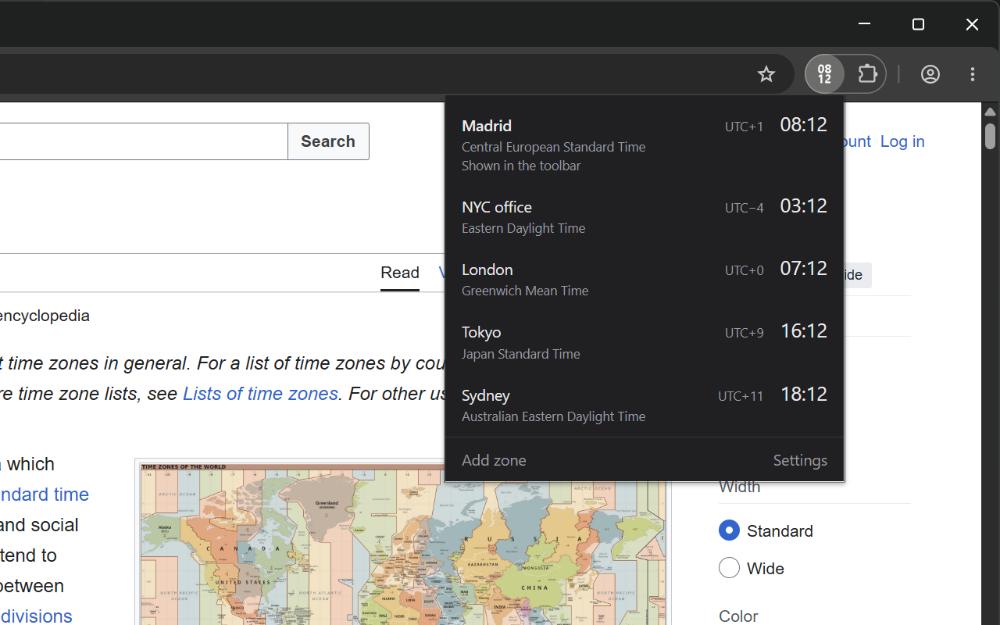

<p align="center"></p>

# Minimalistic Toolbar Clock

A Chrome extension that puts a minimal digital clock in the browser toolbar.
The icon shows the time of one zone; click it to see all your time zones,
add as many as you need, and change the settings.

Built for Chrome and works in any Chromium browser (Brave, Edge...) with
Manifest V3. Only asks for the `storage` and `alarms` permissions.



## Install for development

1. Open `brave://extensions` (or `chrome://extensions`).
2. Turn on **Developer mode**.
3. Click **Load unpacked** and pick this folder.
4. Pin the extension from the extensions menu so it stays in the toolbar.

## Tests

```sh
npm test
```

Uses `node:test`, no dependencies. Requires Node 20+.

## Layout

```
manifest.json
_locales/{en,es}/messages.json   UI strings
icons/                       extension icons (16, 32, 48, 128 px)
src/background.js                service worker, redraws the icon every minute
src/icon/render.js               draws the icon with OffscreenCanvas
src/lib/time.js                  pure time helpers (tested)
src/lib/settings.js              settings schema and storage
src/popup/                       popup UI
test/                            node:test suites
dev/                             icon and popup preview pages (serve the repo over http),
                                 make-icons.py regenerates icons/ (needs Pillow)
```

## Privacy

The extension collects no data. See [PRIVACY.md](PRIVACY.md).

## License

MIT
